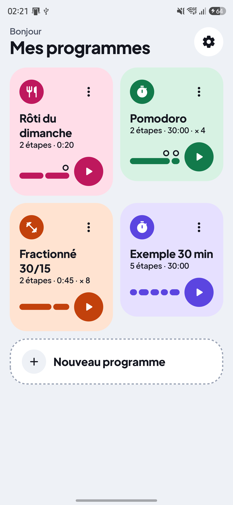
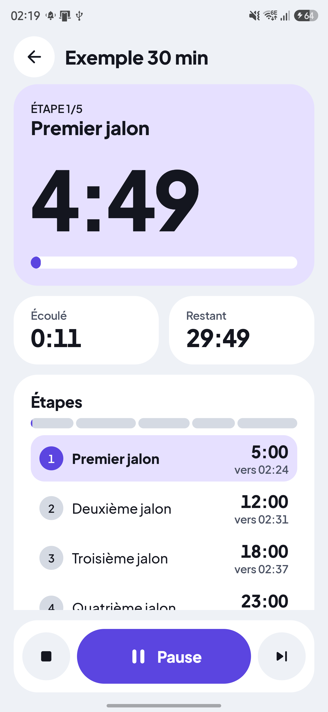
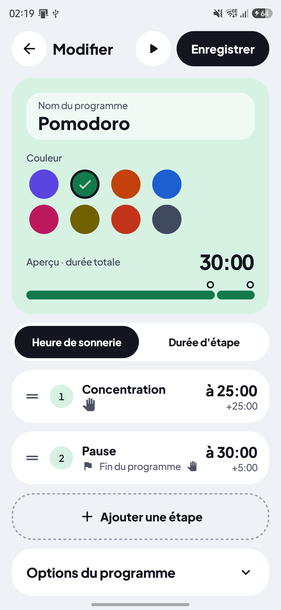
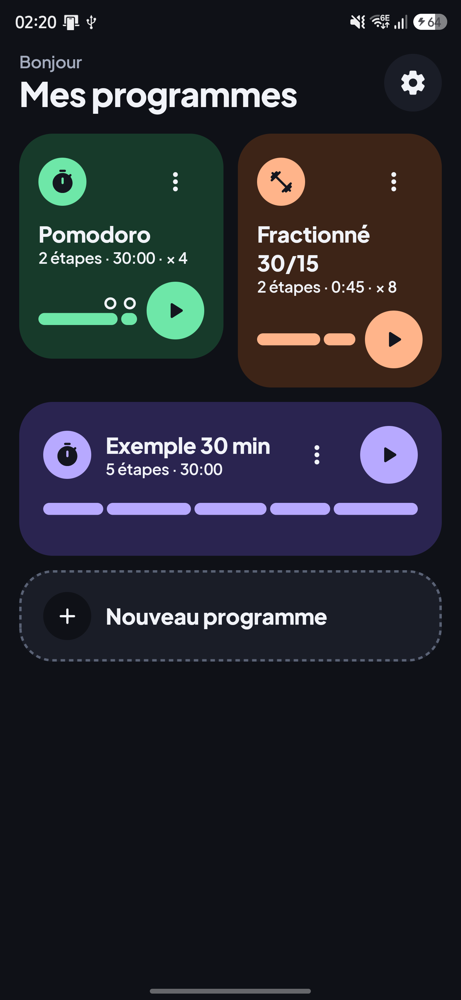
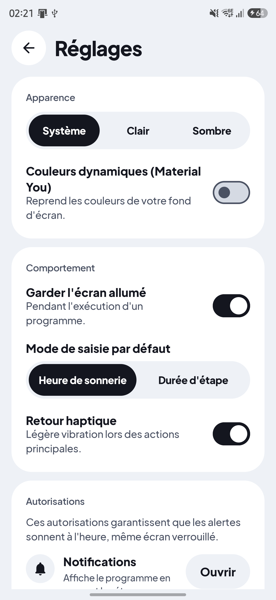

# Ding!

**Chaque étape, pile à l'heure.**

<p align="center"></p>

Ding! est une application Android de **programmes de minuteurs chaînés** : une suite d'étapes qui sonnent à des instants précis depuis le départ, par exemple à 5, 12, 18 et 23 minutes, puis fin à 30 minutes. Chaque étape peut aussi attendre votre validation : le chrono se gèle tant que vous n'avez pas confirmé l'étape atteinte.

## Captures d'écran

| | | |
|:-:|:-:|:-:|
|  |  |  |
|  |  |  |

## Fonctionnalités

- Éditeur d'étapes par **heure de sonnerie** ou par **durée d'étape**
- Réorganisation des étapes par **glisser-déposer**
- Son, vibration et **annonce vocale** réglables étape par étape
- **Répétitions** du programme (nombre de cycles, ou infini)
- **Alarmes exactes**, fiables même écran verrouillé
- **Alerte plein écran** et notification avec actions
- **Reprise** du programme après une fermeture de l'application par Android
- Thème clair et sombre
- **Import / export JSON** de vos programmes

## Vie privée

Ding! fonctionne **100 % hors ligne** : l'application ne déclare aucune permission INTERNET, ne demande aucun compte et ne collecte aucune donnée. Vos programmes restent sur votre appareil.

## Installation

1. Téléchargez l'APK depuis la [page Releases](https://github.com/pingoo78/ding/releases) ou depuis <https://growthtracker.pingooweb.fr/ding/>.
2. Autorisez l'installation d'applications inconnues pour votre navigateur ou gestionnaire de fichiers.
3. Ouvrez l'APK pour l'installer (Android 8.0 ou plus récent).

Empreinte SHA-256 du certificat de signature :

```
30:75:92:BB:03:08:3E:AD:D7:53:73:84:6A:08:12:59:
E2:69:24:B7:6B:5A:D7:76:CF:9C:38:36:BA:1F:AE:E0
```

## Autorisations

- **Notifications** : afficher l'étape en cours et ses actions (valider, pause, arrêt).
- **Alarmes exactes** : déclencher chaque étape à la seconde près, écran verrouillé.
- **Affichage plein écran** : montrer l'alerte d'étape par-dessus l'écran de verrouillage.
- **Service au premier plan** : garder le programme actif pendant son exécution.
- **Vibration** : faire vibrer l'appareil à chaque étape.

## Compiler

Prérequis : JDK 21 (le JBR d'Android Studio convient) et SDK Android 35.

```
./gradlew assembleDebug
```

Pour une release signée, créez à la racine un fichier `keystore.properties` (non versionné) contenant les clés `storeFile`, `storePassword`, `keyAlias` et `keyPassword` :

```
storeFile=
storePassword=
keyAlias=
keyPassword=
```

## Stack

Kotlin 2.2, Jetpack Compose avec Material 3, DataStore et kotlinx.serialization, moteur de minuterie pur et testé unitairement.

## Licence

[GPL-3.0](LICENSE). La police Plus Jakarta Sans est sous licence SIL OFL 1.1 (voir [NOTICE](NOTICE)).
